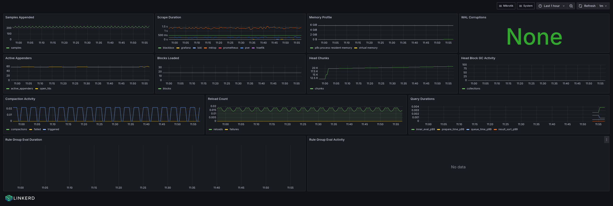
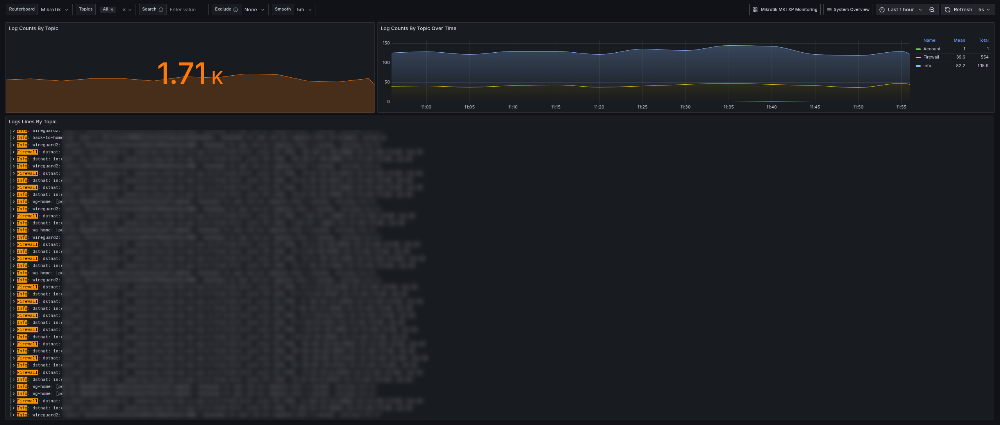
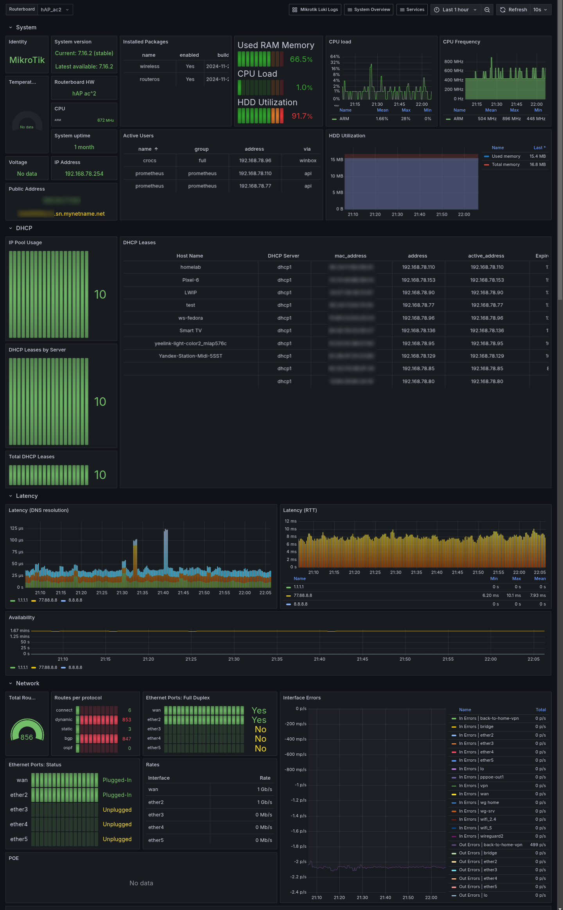
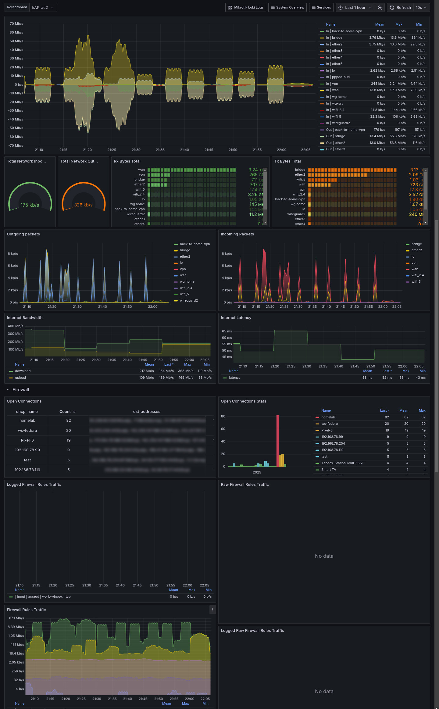
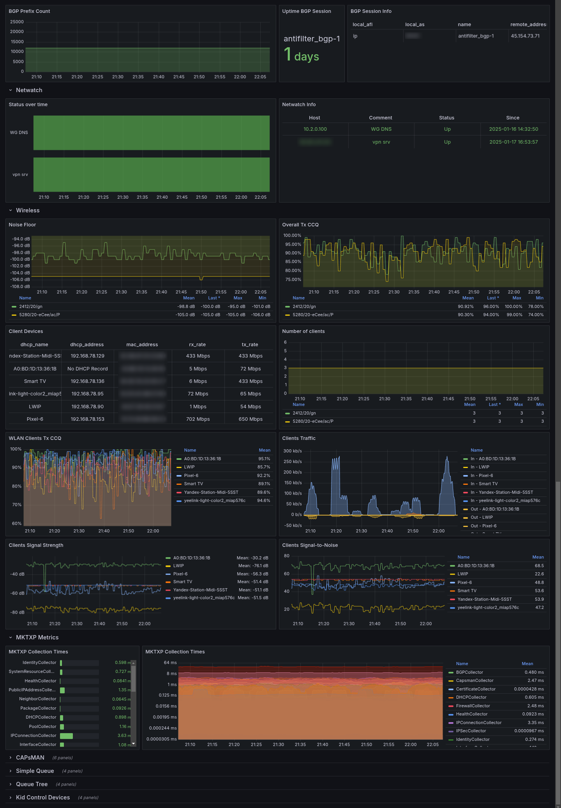
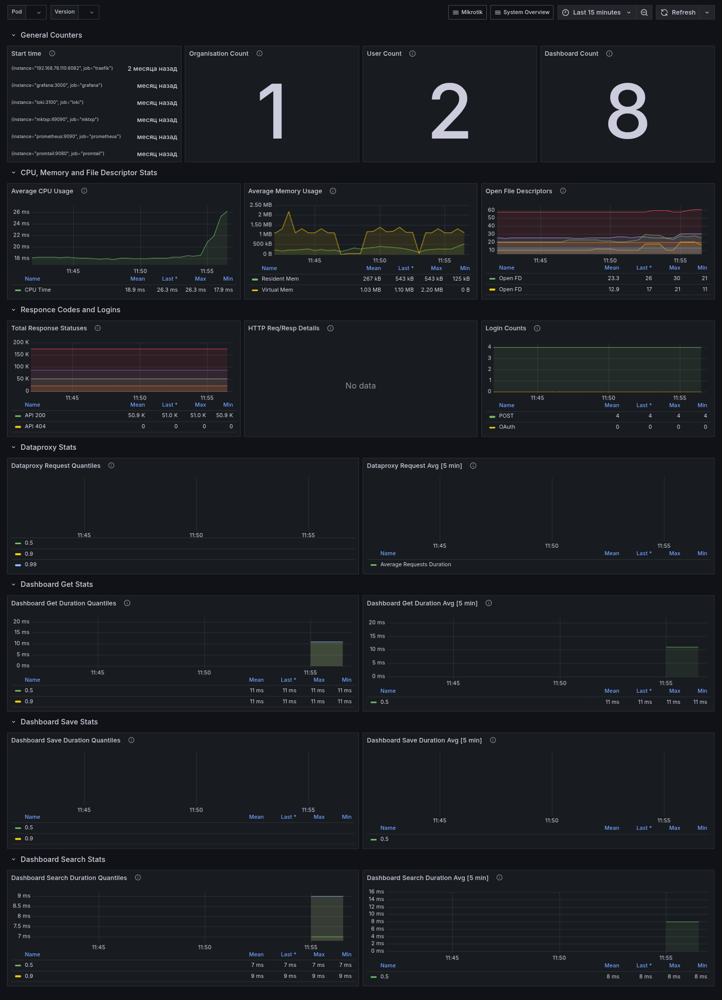

# MKT Monitoring

Стек мониторинга устройств MikroTik на Docker: сбор метрик через RouterOS API, визуализация в Grafana, алертинг через Alertmanager и централизованный сбор логов в Loki.



## Архитектура

```
┌─────────────┐     ┌─────────┐     ┌───────────┐     ┌─────────┐
│  MikroTik   │────▶│  MKTXP  │────▶│ Prometheus │────▶│ Grafana │
│  RouterOS   │ API │ :49090  │     │   :9090   │     │  :3003  │
│  7.x :8728  │     │ внутри  │     │           │     │         │
└─────────────┘     └─────────┘     └─────┬─────┘     └─────────┘
       │                                  │  ▲             ▲
       │ syslog                           │  │             │
       │ UDP 514 / TCP 601                │  │             │
       ▼                                  │  │             │
┌─────────────┐     ┌─────────┐     ┌─────┴─────┐     ┌─────────┐
│ syslog-ng   │────▶│ Promtail│────▶│   Loki    │────▶│ Grafana │
│             │:1514│  :9080  │     │   :3100   │     │         │
└─────────────┘  TCP└─────────┘     └───────────┘     └─────────┘

┌─────────────┐     ┌───────────┐
│ Blackbox    │────▶│ Prometheus│  ICMP-проверки (icmp_ttl5)
│  Exporter   │     │           │
│   :9115     │     │           │
└─────────────┘     └───────────┘

┌─────────────┐     ┌───────────┐
│Node Exporter│────▶│ Prometheus│  метрики сервера
│   :9100     │     │           │
└─────────────┘     └───────────┘

┌──────────────────┐     ┌───────────┐
│ Amnezia WG Easy  │────▶│ Prometheus│  метрики VPN
│ :51820/udp       │     │   :51821  │
│ :51821/tcp       │     │           │
└──────────────────┘     └───────────┘

┌──────────────────┐     ┌───────────┐
│ cAdvisor         │────▶│ Prometheus│  метрики контейнеров Docker
│ внутри сети      │     │           │
└──────────────────┘     └───────────┘

Prometheus ──▶ Alertmanager (:9093) ──▶ Telegram
```

Все 11 сервисов в одной docker-сети `monitoring`, обращаются друг к другу по именам контейнеров.

## Сервисы

| Сервис | Образ | Порт (хост) | Назначение |
|--------|-------|-------------|------------|
| **Grafana** | `grafana/grafana:latest` | 3003→3000 | Веб-интерфейс визуализации |
| **Prometheus** | `prom/prometheus:latest` | 9090 | Сбор и хранение метрик |
| **MKTXP** | `ghcr.io/akpw/mktxp:latest` | 49090 (внутри сети) | Экспорт метрик MikroTik через API |
| **Blackbox Exporter** | `quay.io/prometheus/blackbox-exporter:latest` | 9115 | ICMP-проверка доступности |
| **Node Exporter** | `prom/node-exporter` | 9100 | Метрики сервера |
| **cAdvisor** | `gcr.io/cadvisor/cadvisor:latest` | нет (внутри сети) | Метрики контейнеров Docker: CPU, память, сеть, диск |
| **Amnezia WG Easy** | `ghcr.io/wowly/amnezia-wg-easy:latest` | 51820/udp, 51821/tcp | VPN-сервер с экспортом метрик |
| **Loki** | `grafana/loki:latest` | 3100 | Агрегация логов |
| **Promtail** | `grafana/promtail:latest` | 1514, 9080 | Приём syslog, отправка в Loki |
| **syslog-ng** | `balabit/syslog-ng:latest` | 514/udp, 601/tcp | Приём syslog от MikroTik, пересылка в Promtail |
| **Alertmanager** | `prom/alertmanager:latest` | 9093 | Маршрутизация алертов, отправка в Telegram |

Порты на хост публикуют все, кроме MKTXP — его метрики забирает Prometheus по внутренней сети. cAdvisor наружу не публикуется вовсе: Prometheus достаёт его по имени контейнера внутри docker-сети `monitoring`, а внешнего доступа к нему не требуется.

Единственный именованный том — `etc_amnezia_wg` (конфиги WireGuard). Данные Grafana и Prometheus хранятся в bind-mount каталогах `grafana/data` и `prometheus/data`.

Проверенные версии: Prometheus 3.15.0, Grafana 13.2.3. Образы помечены `:latest`, поэтому при обновлении состав версий меняется — проверяйте совместимость дашбордов. Именно на переходе с Grafana 2.x на 13.x и Prometheus 2.x на 3.x пришлось переписать оба дашборда в папке System: часть метрик Grafana переименована, часть удалена, а дашборд Internals изначально рассчитан на Grafana Cloud в Kubernetes.

## Структура проекта

```
mkt_monitoring/
├── docker-compose.yml              # Оркестрация всех сервисов
├── Makefile                        # make run / make clean
├── .env                            # TELEGRAM_BOT_TOKEN и TELEGRAM_CHAT_ID (в git не отслеживается)
├── .env.example                    # Шаблон .env с плейсхолдерами
├── .gitignore
├── TestAlertmanager                # curl-скрипт проверки Telegram-уведомлений
├── mktxp/
│   ├── mktxp.conf                  # Устройства MikroTik + модули сбора (рабочий)
│   ├── credentials.yml             # Логин и пароль API (в git не отслеживается)
│   ├── credentials.yml.example     # Шаблон credentials.yml
│   └── _mktxp.conf                 # Секции [MKTXP] и [DIAG] (справочные, не подключены)
├── prometheus/
│   ├── prometheus.yml              # Targets, интервалы, alerting, rule_files
│   ├── alerts.rules                # 6 правил алертинга
│   └── data/                       # TSDB (в git не отслеживается)
├── blackbox/
│   └── blackbox.yml                # Модуль icmp_ttl5
├── alertmanager/
│   ├── alertmanager.yml.tmpl        # Маршрут + Telegram-ресивер (шаблон с ${TELEGRAM_*})
│   ├── entrypoint.sh                # Подстановка переменных из .env через sed
│   ├── data/                        # nflog, silences (в git не отслеживается)
│   └── templates/
│       ├── telegram.tmpl           # Шаблон сообщения (рабочий)
│       └── telegram.tmpl_          # Предыдущая версия
├── grafana/
│   ├── conf/provisioning/
│   │   ├── datasources/
│   │   │   ├── prometheus.yaml     # По умолчанию
│   │   │   └── loki.yaml
│   │   └── dashboards/
│   │       ├── mikrotik.yml        # → папка Mikrotik
│   │       │   ├── mikrotik_mktxp_exporter.json   (96 панелей)
│   │       │   └── mikrotik_loki_logs.json       (3 панели, логи syslog)
│   │       ├── amnezia.yml         # → папка amnezia
│   │       │   └── amnezia/amnezia-wg-easy.json          (7 панелей)
│   │       └── system.yml          # → папка System
│   │           ├── system/system_grafana_internals.json   (19 панелей)
│   │           ├── system/system_prometheus_stats.json    (14 панелей)
│   │           └── system/docker.json                     (44 панели: контейнеры и хост)
│   └── data/                       # grafana.db, плагины, unified-search
├── loki/
│   ├── loki-config.yml             # Рабочий конфиг (tsdb, схема v13)
│   └── loki-config-2.x.yml         # Вариант для Loki 2.x (не подключён)
├── promtail/
│   ├── promtail-config.yml         # Рабочий: приём syslog на :1514
│   └── promtail-config-fs.yml      # Вариант «чтение логов из файлов» (не подключён)
├── syslog-ng/
│   ├── syslog-ng.conf              # Рабочий: приём → promtail:1514
│   ├── syslog-ng-fs.conf           # Вариант «запись в файлы» (не подключён)
│   └── logs/.gitkeep               # Каталог под альтернативный конфиг
├── amnezia/
│   ├── .env                        # Параметры VPN-сервера
│   └── docker-compose.yml          # Стенд для отдельного запуска (в основном compose не используется)
└── assets/                         # Скриншоты дашбордов
```

Файлы с суффиксами `_`, `._`, `_old` и `*-config-fs.yml` — неиспользуемые варианты конфигурации, оставлены как резервные копии.

В `grafana/data` лежат 18 предустановленных плагинов (loki, prometheus, tempo, jaeger, influxdb, mysql, postgresql, mssql, opentsdb, stackdriver, zipkin, elasticsearch, grafana-lokiexplore-app, grafana-metricsdrilldown-app, grafana-exploretraces-app, grafana-pyroscope-app, grafana-pyroscope-datasource, grafana-advisor-app) и база `grafana.db`. Каталог целиком в `.gitignore` и в git не отслеживается: состояние дашбордов, созданных или изменённых в UI, хранится только в `grafana/data/grafana.db` и не переносится в репозиторий автоматически. Чтобы перенести правку layout в файл, экспортируйте дашборд из UI и замените соответствующий JSON в `grafana/conf/provisioning/dashboards`.

## Требования

- Docker и Docker Compose v2
- MikroTik RouterOS 7.x с доступом по API (порт 8728)
- Ubuntu 24.04 (протестировано)
- Для Amnezia WG Easy: `/dev/net/tun` и право `NET_ADMIN`
- Каталоги `prometheus/data` и `grafana/data` создаются с непривилегированными владельцами, иначе контейнеры уйдут в рестарт с `permission denied`:

```bash
mkdir -p prometheus/data grafana/data
chown -R 65534:65534 prometheus/data   # uid nobody в prom/prometheus
chown -R 472:0 grafana/data             # uid grafana в grafana/grafana
```

## Быстрый старт

### 1. Подготовка MikroTik

```bash
/user group add name=prometheus policy=api,read
/user add name=prometheus group=prometheus password=YourStrongPassword
```

### 2. Установка

```bash
bash <(curl -sSL https://get.docker.com)
sudo usermod -aG docker ${USER}
newgrp docker

git clone https://github.com/staffrf-png/mkt_monitoring.git
cd mkt_monitoring
cp .env.example .env                  # токен Telegram-бота и chat_id
cp mktxp/credentials.yml.example mktxp/credentials.yml   # логин и пароль API MikroTik
nano mktxp/credentials.yml
```

### 3. Конфигурация

#### MKTXP (`mktxp/mktxp.conf`)

Секция `[default]` — общие параметры и модули сбора; секции `[Router-N]` — конкретные устройства, наследуют `[default]` и переопределяют отдельные параметры.

```ini
[default]
    enabled = True
    hostname = 10.54.1.254
    port = 8728
    username = prometheus
    credentials_file = /root/mktxp/credentials.yml
    use_ssl = False
    plaintext_login = True
    timeout = 30
    log_level = DEBUG

    route = True
    routing_stats = True
    health = True
    wireless = True
    bgp = True
    ipsec = True
    poe = True
    public_ip = True
    switch_port = True
    user = True
    check_for_updates = True
    installed_packages = True

    interface = True
    firewall = True
    dhcp = True
    monitor = True
    connections = True
    pool = True
    neighbor = True
    dns = True
    dhcp_lease = True

[Router-1]
    hostname = 10.54.1.254

[Router-2]
    hostname = 10.54.2.254
    route = False
    timeout = 45
```

Секция `[new_default_parameters]` в конце файла содержит новые параметры текущей версии MKTXP. Значения, отличные от `False`/`None`, переносятся в `[default]`, остальные можно не трогать.

Отключённые модули: `lte`, `eoip`, `ipip`, `netwatch`, `queue`, `certificate`, `capsman`, `kid_control_*`, `routerboard`, `ipv6_*`, `gre`, `bfd`, `wireguard_peers` и другие. Включайте по необходимости — каждый добавляет время к сбору.

Секции `[MKTXP]` (listen-адрес, таймауты, пул соединений) и `[DIAG]` (пороги деградации) лежат в справочном файле `mktxp/_mktxp.conf` и по умолчанию не применяются. Порт MKTXP по умолчанию — `0.0.0.0:49090`, это соответствует `scrape_configs` в Prometheus.

Конфиг монтируется в контейнер (`./mktxp/:/root/mktxp/`), но перечитывается только при старте — после правки нужен `docker compose restart mktxp`.

#### Prometheus (`prometheus/prometheus.yml`)

Глобально: `scrape_interval: 45s`, `scrape_timeout: 30s`, `evaluation_interval: 15s`, внешняя метка `origin_prometheus: mktxp`.

| Job | Интервал | Target |
|-----|----------|--------|
| `node` | 5s | `node-exporter:9100` |
| `mktxp` | 45s | `mktxp:49090` |
| `grafana` | 45s | `grafana:3000` |
| `loki` | 45s | `loki:3100` |
| `promtail` | 45s | `promtail:9080` |
| `amnezia-wg-easy` | 30s | `172.54.0.2:51821` (внешний сервер) |
| `amnezia-wg-easy2` | 30s | `amnezia-wg-easy2:51821` (локальный контейнер) |
| `blackbox` | 1s | `1.1.1.1`, `10.54.1.254`, `77.88.8.8` через модуль `icmp_ttl5` |
| `prometheus` | 45s | `localhost:9090` (сам Prometheus, нужен для дашборда Prometheus 2.0 Stats) |
| `cadvisor` | 10s | `cadvisor:8080` (метрики контейнеров Docker) |

Всего 12 целей. Blackbox-метрики пробрасываются через `relabel_configs`: адрес цели превращается в `__param_target`, `__address__` подменяется на `blackbox:9115`.

Без job `prometheus` дашборд Prometheus 2.0 Stats остаётся пустым: все его панели фильтруют `{job="prometheus"}`, и без самоскрейпа под серией нет ни одной метрики.

Интервал 1s у blackbox — самый агрессивный расход. Он даёт детальную картину потерь, но при росте числа целей нагрузка растёт линейно.

У cAdvisor интервал 10s, а не общие 45s: часть его метрик (`container_pressure_*`, состояния задач в cgroup) обновляется раз в секунду, и при редком опросе динамика в этих панелях рассыпается на ступени. Интервал меньше 10s не имеет смысла — сам cAdvisor пересчитывает состояния раз в 10 секунд (`--housekeeping_interval=10s`).

Подключение Alertmanager (`alertmanager:9093`) и правила (`alerts.rules`) включены.

#### Alertmanager (`alertmanager/alertmanager.yml.tmpl`)

```yaml
receivers:
- name: telegram
  telegram_configs:
    - api_url: 'https://api.telegram.org'
      bot_token: '${TELEGRAM_BOT_TOKEN}'
      chat_id: ${TELEGRAM_CHAT_ID}
      send_resolved: true
```

Значения подставляются из `.env` при старте контейнера, в репозитории их нет. Подробности — в разделе [Настройка Telegram-бота](#настройка-telegram-бота).

Маршрут группирует каждый алерт отдельно (`group_by: ['...']`): `group_wait: 5s`, `group_interval: 1s`, `repeat_interval: 10m`. Шаблон — `alertmanager/templates/telegram.tmpl`, использует разметку Telegram (`*жирный*`, `<b>`, ссылки).

Проверка доставки:

```bash
bash TestAlertmanager
```

Скрипт отправляет тестовый алерт через API Alertmanager — проверьте, дошло ли сообщение в Telegram.

#### Grafana

Учётные данные администратора задаются в `.env` в корне:

```env
ADMIN_USER=admin
ADMIN_PASSWORD=admin
```

Текущий `.env` содержит копию параметров Amnezia (включая `WG_HOST` и `PASSWORD_HASH`) и не используется ни одним сервисом — `ADMIN_USER`/`ADMIN_PASSWORD` в нём нет, поэтому Grafana стартует с `admin`/`admin`.

Остальное — в `docker-compose.yml`: язык `ru-RU`, тема `dark`, регистрация отключена, дашбордом по умолчанию открывается `Mikrotik MKTXP Monitoring`.

#### Amnezia WG Easy (`amnezia/.env`)

```env
WG_PORT=51820                    # Порт VPN (UDP)
PORT=51821                       # Порт веб-интерфейса (TCP)
WG_HOST=your.domain.ru           # Публичный IP или домен
PASSWORD_HASH='$2a$12$...'      # bcrypt-хеш пароля веб-интерфейса
ENABLE_PROMETHEUS_METRICS=true   # Экспорт метрик
UI_TRAFFIC_STATS=true            # Детальная статистика трафика в UI

# Параметры маскировки (обход DPI)
WG_JC=6
WG_JMIN=10
WG_JMAX=30
WG_S1=70
WG_S2=110
```

Генерация хеша:

```bash
docker run --rm ghcr.io/wowly/amnezia-wg-easy node -e "console.log(require('bcryptjs').hashSync('your_password', 10))"
```

Compose подключает именно `amnezia/.env` через `env_file`.

### 4. Запуск

Проверьте конфигурацию Prometheus заранее — контейнер не поднимется при ошибке в `rule_files`:

```bash
docker run --rm -v "$PWD/prometheus:/etc/prometheus:ro" \
  --entrypoint promtool prom/prometheus:latest check config /etc/prometheus/prometheus.yml
docker run --rm -v "$PWD/prometheus:/etc/prometheus:ro" \
  --entrypoint promtool prom/prometheus:latest check rules /etc/prometheus/alerts.rules
```

Старт:

```bash
docker compose up -d      # фоновый режим
make run                  # docker compose up — с логами в терминале
```

Перезагрузка конфигурации Prometheus без перезапуска (флаг `--web.enable-lifecycle` уже прописан):

```bash
curl -X POST http://localhost:9090/-/reload
```

### 5. Проверка после запуска

Все 10 контейнеров должны быть в статусе `Up` без рестартов, а targets Prometheus — `up`:

```bash
docker compose ps
curl -s 'http://localhost:9090/api/v1/targets?state=active' | python3 -m json.tool
```

Состояние на момент последней проверки стенда (полное пересоздание с нуля):

| Проверка | Результат |
|----------|-----------|
| Контейнеры | 10/10 `Up`, рестартов 0 |
| Targets Prometheus | 11/11 `up` (включая сам Prometheus) |
| Правила алертинга | 1 группа / 6 правил, все `inactive` |
| Alertmanager | `activeAlertmanagers: [alertmanager:9093]` |
| Telegram | `alertmanager_notifications_total{integration="telegram"} = 1`, ошибок 0 |
| Grafana | 4 дашборда в 3 папках, 2 datasource отвечают |
| Loki | цепочка syslog-ng → promtail → Loki работает, метки `job`, `routerboard`, `service_name`, `syslog_host` |
| Blackbox | 3/3 `probe_success = 1` |
| Amnezia WG Easy | веб 200, 0 пиров на чистом томе |

Известные особенности стенда:

- **Router-3 (`10.54.3.254`) недоступен** — MKTXP получает `Connection ... has failed: timed out`. Это сетевая недоступность устройства, а не ошибка конфигурации. Router-1, Router-1-2 и Router-2 собираются штатно.
- **Router-4 отсутствует** в `mktxp.conf`. Если в Grafana встречается `Router-4` — это устаревшая серия в старом хранилище Prometheus; очистите `prometheus/data` или дождитесь истечения retention.
- **Amnezia на чистом томе содержит 0 пиров** — конфигурации клиентов удалены вместе с volume. Восстановление из резервной копии: `docker run --rm -v mkt_monitoring_etc_amnezia_wg:/etc/amnezia -v /opt/backup:/backup alpine tar xzf /backup/amnezia_wg_volume_*.tar.gz -C /etc/amnezia`.

### 6. Доступ

| Интерфейс | Адрес | Учётные данные |
|-----------|-------|----------------|
| Grafana | `http://server_ip:3003` | `ADMIN_USER` / `ADMIN_PASSWORD` |
| Prometheus | `http://server_ip:9090` | — |
| Alertmanager | `http://server_ip:9093` | — |
| Blackbox Exporter | `http://server_ip:9115` | — |
| Node Exporter | `http://server_ip:9100` | — |
| Loki | `http://server_ip:3100` | — |
| Promtail | `http://server_ip:9080` | — |
| Amnezia WG Easy | `http://server_ip:51821` | пароль из `PASSWORD_HASH` |

cAdvisor портов на хост не имеет и в списке нет намеренно: его `/metrics` доступен только внутри docker-сети, снаружи появляется вместе с ним.

#### cAdvisor

Единственный источник метрик по отдельным контейнерам Docker. Node Exporter про хоста о метриках контейнеров не знает, поэтому без cAdvisor дашборд Docker показывал бы только общую нагрузку машины.

Запускается с `privileged: true` и монтированиями `/`, `/var/run`, `/sys`, `/var/lib/docker` и `/dev/disk` — иначе сборщик не видит ни список контейнеров, ни их файловые системы. Это read-only-монтирования, но `privileged` снимает изоляцию полностью: контейнер видит хост и может в него писать.

Ключевые флаги:

| Флаг | Зачем |
|------|-------|
| `--docker_only=true` | Только Docker, без метрик Kubernetes и systemd-контейнеров |
| `--housekeeping_interval=10s` | Как часто пересчитываются состояния cgroup; от этого зависит минимальный разумный интервал опроса |
| `--store_container_labels=true` | Метки контейнеров попадают в метрики, по ним удобно фильтровать в Grafana |

Метрики, которые даёт (`container_*`): CPU (пользовательское, системное, суммарное), память (рабочая, RSS, кеш, максимум, подкачка, отказы выделения, `container_oom_events_total`), сеть (байты, пакеты, ошибки, потери), диск (чтение и запись, операции, время ожидания, inode, лимиты), а также `container_start_time_seconds`, `container_last_seen`, `container_scrape_error`, `container_spec_memory_limit_bytes` и PSI-метрики `container_pressure_*`.

Отдельная полезная метрика — `machine_*`: ядра, память и подкачка всей машины, дублирующие часть node_exporter, но берущиеся из того же опроса.

## Сбор логов MikroTik

Цепочка: MikroTik → syslog-ng (:514/udp, :601/tcp) → Promtail (:1514/tcp) → Loki → Grafana.

Promtail добавляет метки:

- `routerboard` — из `__syslog_message_hostname` (hostname отправителя в сообщении)
- `syslog_host` — из `__syslog_connection_hostname` (адрес, с которого пришло)

В Grafana источник называется `Loki`, `maxLines: 1000`. Просмотр собранных записей — на дашборде [Mikrotik Loki Logs](#mikrotik-loki-logs) в папке Mikrotik.

Настройка MikroTik:

```bash
/system logging action
set remote bsd-syslog=yes name=remote remote=XX.XX.XX.XX remote-port=514 src-address=0.0.0.0 syslog-facility=local0 syslog-severity=auto target=remote

/system logging
set 0 action=remote prefix=:Info
set 1 action=remote prefix=:Error
set 2 action=remote prefix=:Warning
set 3 action=remote prefix=:Critical

add action=remote disabled=no prefix=:Firewall topics=firewall
add action=remote disabled=no prefix=:Account topics=account
add action=remote disabled=no prefix=:Caps topics=caps
add action=remote disabled=no prefix=:Wireles topics=wireless
```

Пример запроса в Grafana:

```logql
{routerboard="<hostname>"} |~ "(?i)error|critical|down"
```

Особенности хранения:

- Loki пишет в `path_prefix: /tmp/loki`, том не пробрасывается — **логи теряются при пересоздании контейнера**
- Promtail хранит позиции в `/tmp/positions.yaml` — при пересоздании возможна повторная отправка старых записей
- Loki без аутентификации (`auth_enabled: false`), `replication_factor: 1`

Альтернативные конфигурации (`promtail-config-fs.yml`, `syslog-ng-fs.conf`, `loki-config-2.x.yml`) рассчитаны на другие сценарии: чтение логов из файлов вместо приёма syslog и Loki 2.x с boltdb-shipper. Чтобы включить, замените путь в `volumes` соответствующего сервиса в `docker-compose.yml`.



## Дашборды

Загружаются из `grafana/conf/provisioning/dashboards` при старте Grafana. Каталог провайдера соответствует папке в Grafana: `mikrotik` → Mikrotik, `amnezia` → amnezia, `system` → System. Обновление раз в 10 секунд, правки в UI разрешены (`allowUiUpdates: true`). У провайдера `amnezia` включён `disableDeletion: true`.

Два дашборда (`mikrotik`, `amnezia`) хранятся в формате Grafana `dashboard.grafana.app/v2`: панели описаны в `spec.elements`, размеры — в `spec.layout`. Дашборды System остались в классическом формате с массивом `panels`.

Автообновление всех дашбордов — 10 секунд. Часовой пояс у всех пяти `Asia/Novosibirsk`, он не зависит от настроек браузера. Микротик: период `now-1h` → `now`. WireGuard: `now-15m` → `now`.

### Mikrotik MKTXP Monitoring

Основной дашборд: 96 панелей, 123 запроса, 73 уникальные метрики. Переменные: `node` (`label_values(mktxp_system_identity_info, routerboard_name)`), `wg_job` и `wg_node` для панелей WireGuard.

Панели описаны: описание выводится по наведению на заголовок и говорит, что именно выводит запрос панели, с единицами измерения. Там, где заголовок расходится с содержимым, описан запрос, а не заголовок — например, `Routerboard HW` берёт `mktxp_system_uptime` ради лейбла `board_name` и показывает модель платы, а в значении у него время работы в секундах.

Вкладка **New tab** перестроена по значимости, в каждом ряду ширины панелей выровнены:

| Ряд | Панели | Высота |
|-----|--------|--------|
| 1 | `Identity`, `Routerboard HW`, `System version`, `Public Address`, `IP Address`, `System uptime` | 3 |
| 2 | `Temperature`, `Total Network Inbound`, `Total Network Outbound`, `Total Routes` | 5 |
| 3 | `Resources`, `CPU load`, `CPU Frequency`, `Memory` | 6 |
| 4 | `Total Network`, `Throughput`, `Total Routes` (график), `Traffic Stats` | 10 |
| 5 | Таблица WireGuard по пирам | 10 |

Панели `Total Routes` — три штуки: две стат-панели (на `New tab` и `System`) и график динамики числа маршрутов на `New tab`. График показывает значение как есть, в штуках, без округления и сокращений (`suffix:шт`, `decimals: 0`), и легендой в виде таблицы.

| Группа метрик | Панели |
|---------------|--------|
| `mktxp_system_*` | CPU load, CPU frequency, CPU temperature, uptime (×2), System version (×2), Identity (×2), Routerboard HW (×2), HDD Utilization, Temperature (×2), Voltage, Installed Packages, Public Address (×2), IP Address (×2) |
| `mktxp_interface_*` | Interface traffic, Rates, Incoming/Outgoing Packets, Rx/Tx Bytes Total, Total Network Inbound/Outbound, Throughput, Total Network, Interface Errors, Ethernet Ports: Status и Full Duplex |
| `mktxp_queue_*` | Simple Queue — Rates, Processed/Queued/Dropped Bytes (download + upload); Queue Tree — Rates, Processed/Queued/Dropped |
| `mktxp_wlan_*` | Noise Floor, Overall Tx CCQ, WLAN Clients Tx CCQ, Clients Signal Strength, Clients Signal-to-Noise, Clients Traffic, Registered Client Signal Strength, Client Devices, Number of clients |
| `mktxp_capsman_*` | Remote Caps, CAPsMAN Registrations, CAPsMAN Clients, CAPsMAN Clients Traffic, CAPsMan Clients Signal Strength |
| `mktxp_dhcp_lease_*` | DHCP Leases, DHCP Leases by Server, Total DHCP Leases |
| `mktxp_routes_*` | Total Routes (×2), Routes per protocol |
| `mktxp_bgp_*` | BGP Prefix Count, BGP Session Info, Uptime BGP Session |
| `mktxp_firewall_*` | Firewall Rules Traffic, Raw Firewall Rules Traffic, Logged Firewall Rules Traffic, Logged Raw Firewall Rules Traffic |
| `mktxp_internet_*` | Internet Bandwidth, Internet Latency, Latency (RTT), Latency (DNS resolution), Availability |
| `mktxp_kid_control_*` | Client Devices, Data Transfers, Transfer Rates, Idle Times, Connected Devices, Active Users |
| Прочее | `mktxp_ip_pool_used` (IP Pool Usage), `mktxp_poe_info` (POE, Status over time), `mktxp_netwatch_*` (Netwatch Info), `mktxp_public_ip_address_info`, `mktxp_connection_stats` (Open Connections, Open Connections Stats), `mktxp_active_users_info`, `mktxp_collection_time_total` (MKTXP Collection Times ×2), Traffic Stats |





### Mikrotik Loki Logs

3 панели, 3 запроса LogQL к Loki. Дашборд создан в UI Grafana и выгружен в репозиторий, часовой пояс в нём не задан — используется тот, что выбран в Grafana.

- Log Counts By Topic — счётчик записей по темам
- Log Counts By Topic Over Time — динамика по темам
- Logs Lines By Topic — сами строки журнала с поиском

Переменные `routerboard`, `topics` и `searchable_pattern`; источник логов — поток syslog, принятый `syslog-ng` на `:1514` и переданный в Loki через `promtail`.

### WireGuard wg-easy

7 панелей, 10 запросов. Переменные `job` и `node` через `label_values(wireguard_configured_peers, job)`.

- Configured Peers, Enabled Peers, Connected Peers
- Online Clients (время последнего handshake)
- Таблица трафика по клиентам с разделением Upload / Download
- Throughput и Traffic Stats (`rate(...[5m])` по каждому пиру)

Веб-интерфейс Amnezia WG Easy: `http://server_ip:51821`.

Возможности веб-интерфейса:

- Управление клиентами: создание, редактирование, удаление, вкл/выкл
- QR-код для мобильных клиентов
- Скачивание конфига `.conf` для каждого клиента
- Статистика: подключённые клиенты, графики Tx/Rx
- One Time Links — временные ссылки на скачивание (по умолчанию выключено)
- Client Expiry — ограничение срока действия клиента (по умолчанию выключено)
- Traffic Stats — детальная статистика трафика (по умолчанию выключено)

### System

- **Grafana Internals** (19 панелей) — счётчики, CPU/память, файловые дескрипторы, коды ответов, логины, dataproxy, статистика дашбордов
- **Prometheus 2.0 Stats** (14 панелей) — скорость записи сэмплов, длительность скрейпов, память, WAL, компакция, активные аппендеры, latency запросов
- **Docker Monitoring** (44 панели, три вкладки) — мониторинг контейнеров и хоста

#### Docker Monitoring

Дашборд для стека и хост-машины. Контейнеры описывает cAdvisor, хост — node_exporter. Хранится в формате `dashboard.grafana.app/v2`, как и дашборды mikrotik и amnezia.

Единственная переменная: `container` (`label_values(container_last_seen, name)`), по ней фильтруется вкладка «Контейнер».

| Вкладка | Панелей | Содержимое |
|---------|---------|-----------|
| **Обзор** | 13 | Сколько контейнеров в работе, ошибки сбора, ядра, память и подкачка машины; суммарные CPU, память и сеть по всем контейнерам; разбивка CPU, памяти, сети и диска по каждому контейнеру; сводная таблица контейнеров |
| **Контейнер** | 19 | Детализация по выбранному контейнеру: время работы, момент последнего опроса, лимит и доля памяти, отказы выделения; CPU с разбивкой на пользовательское и системное время; память (рабочая, RSS, кеш, максимум) и подкачка; сеть с байтами, пакетами, ошибками и потерями; диск с байтами, операциями и временем ожидания; файловая система и inode; блочный ввод-вывод |
| **Хост** | 12 | CPU по режимам (пользовательское, системное, ожидание ввода-вывода, потеряно гостю), load average, память и подкачка, файловые системы, файлы и inode, сеть с байтами, пакетами и ошибками, ввод-вывод дисков, дескрипторы, PSI-метрики давления, время работы |

Отдельного внимания требуют три группы панелей:

- **Сводная таблица контейнеров** на вкладке «Обзор» — четыре запроса разных типов (`container_memory_working_set_bytes`, `container_spec_memory_limit_bytes`, скорость CPU и время работы). Это самый быстрый способ найти контейнер, который съел память или процессор.
- **PSI-метрики** (`node_pressure_*`, `container_pressure_*`) показывают долю времени, когда хост или контейнер ждал процессор, память или диск. Это то, что показывает перегрузку до того, как её видно по задержкам.
- **Блочный ввод-вывод** (`container_blkio_device_usage_total`) — единственная панель, которая может быть пустой: cAdvisor отдаёт её не для всех версий ядра и не для всех систем хранения.

Оба дашборда System изначально писались под Grafana Cloud и Grafana 2.x, поэтому потребовали правок:

- **Prometheus 2.0 Stats** был полностью пуст, пока Prometheus не скрейпил сам себя. Панели фильтруют `job="prometheus"`, а такого job не было — теперь в `prometheus.yml` есть блок `- job_name: 'prometheus'` с целью `localhost:9090`. Метрика `prometheus_tsdb_compaction_duration_bucket` потеряла вставку `seconds` в Prometheus 3 и заменена на `prometheus_tsdb_compaction_duration_seconds_bucket`. `head_gc` осталась summary, а не гистограммой, поэтому её quantile-запрос сохранён; панель пуста, пока сборщик мусора head ни разу не сработал после старта.
- **Grafana Internals** фильтровал все 30 запросов по `kubernetes_pod_name="$pod"`, а Grafana работает в Docker и такого лейбла не имеет. Переменная `pod` искала его через `label_values(grafana_info, kubernetes_pod_name)`, причём `grafana_info` в Grafana 13 больше не экспортируется. Фильтр заменён на `job="grafana"`, обе переменные удалены. `http_request_total` стал `grafana_http_request_duration_seconds_*`, а метрики `grafana_api_dashboard_get_milliseconds` и `..._save_milliseconds` в 13.x удалены — соответствующие 4 панели и 2 секции-строки убраны.

## Алертинг

Цепочка: Prometheus → Alertmanager (`:9093`) → Telegram. Обе части подключены в `prometheus.yml`.

Правила в `prometheus/alerts.rules` (группа `mikrotik_alerts`, 6 правил):

| Алерт | Условие | for | Severity |
|-------|---------|-----|----------|
| HighCpuUsage | `mktxp_system_cpu_load > 60` | 5m | warning |
| HighMemoryUsage | `(1 - mktxp_system_free_memory / mktxp_system_total_memory) * 100 > 65` | 2m | warning |
| RouterOverheat | `mktxp_system_routerboard_temperature > 40` | 2m | critical |
| RouterCpuOverheat | `mktxp_system_cpu_temperature > 70` | 2m | critical |
| LowUptime | `mktxp_system_uptime < 100` | 0m | warning |
| MikroTikDown | `up{job="mktxp"} == 0` | 5m | critical |

Каждое правило использует лейблы `routerboard_address` и `routerboard_name`, которые добавляет MKTXP.

Температура у RouterOS доступна под двумя разными именами, поэтому правил два. `mktxp_system_routerboard_temperature` есть только у моделей с датчиком на плате (в стенде — Router-2, штатно 22–24 °C, порог 40 °C). `mktxp_system_cpu_temperature` есть, наоборот, только у hAP ax³ (Router-1, штатно 57–58 °C, порог 70 °C). Если оставить одно правило с порогом 30 °C, оно бы срабатывало постоянно на hAP ax³ и молчало на RB2011. Проверьте фактические значения на дашборде перед изменением порогов.

Проверка состояния:

```bash
curl -s http://localhost:9090/api/v1/rules | python3 -m json.tool          # группы и правила
curl -s http://localhost:9090/api/v1/alertmanagers | python3 -m json.tool  # подключён ли AM
curl -s http://localhost:9090/api/v1/alerts | python3 -m json.tool         # активные алерты
```

### Настройка Telegram-бота

Токен и `chat_id` не хранятся в репозитории — они лежат в `.env` (файл в `.gitignore`). Создайте его из шаблона:

```bash
cp .env.example .env
nano .env
```

```ini
TELEGRAM_BOT_TOKEN=1234567890:AAExampleTokenReplaceMe
TELEGRAM_CHAT_ID=-1001234567890
```

`chat_id` личного чата обычно положительный (`1234567890`), группы и супергруппы — отрицательные (`-1001234567890` для супергруппы). Узнать его: напишите боту `/start`, затем откройте `https://api.telegram.org/bot<ТОКЕН>/getUpdates` и найдите `"chat":{"id":...}`.

Дальше Alertmanager нужно пересоздать — конфиг генерируется при старте:

```bash
docker compose up -d --force-recreate alertmanager
```

Механика: `alertmanager/alertmanager.yml.tmpl` — шаблон с плейсхолдерами `${TELEGRAM_BOT_TOKEN}` и `${TELEGRAM_CHAT_ID}`. Entrypoint `alertmanager/entrypoint.sh` подставляет их через `sed` в `/alertmanager/alertmanager.yml` внутри контейнера, после чего запускает Alertmanager.

Проверка доставки:

```bash
bash TestAlertmanager
docker compose logs alertmanager | grep "Notify success"
curl -s http://localhost:9093/metrics | grep 'alertmanager_notifications_total{integration="telegram"}'
```

> ⚠️ Бот должен быть добавлен в чат или группу и иметь право отправки. Если в группе включён режим защиты контента, бот должен быть администратором.



## Команды Makefile

```bash
make run      # docker compose up (attached, логи в терминал)
make clean    # docker compose down + удаление ВСЕХ контейнеров и ВСЕХ томов Docker на хосте
```

> ⚠️ `make clean` выполняет `docker rm -f $(docker ps -a -q)` и `docker volume rm $(docker volume ls -q)`. Команды не ограничены этим проектом и удалят контейнеры и тома других стендов. Для остановки только этого стенда используйте `docker compose down`.

## Диагностика

Состояние targets:

```bash
curl -s 'http://localhost:9090/api/v1/targets?state=active' | python3 -m json.tool
```

Метрики конкретного устройства:

```bash
curl -s http://localhost:9090/api/v1/query --data-urlencode 'query=mktxp_system_identity_info'
```

Логи и перезапуск сервисов:

```bash
docker compose logs -f mktxp
docker compose logs -f loki promtail syslog-ng
docker compose restart grafana
```

| Симптом | Причина |
|---------|---------|
| Prometheus не стартует, `promtool` FAILED | Опечатка в `rule_files` или синтаксис правил — проверьте `check config` и `check rules` |
| `groups: 0` при работающем Prometheus | Правила ещё не перезагружены — `curl -X POST http://localhost:9090/-/reload` |
| `activeAlertmanagers: []` | Alertmanager не запущен или недоступен по сети — `docker compose ps alertmanager` |
| `mktxp` недоступен в Prometheus | Неверные IP/пароль в `mktxp.conf` или закрыт порт 8728. Смотреть `docker compose logs mktxp` |
| Метрики MKTXP не изменились после правки конфига | Конфиг перечитывается только при старте — `docker compose restart mktxp` |
| Логи не появляются в Grafana | Loki пишет в `/tmp/loki` без тома; проверьте цепочку `docker compose logs loki promtail syslog-ng` |
| Запрос LogQL возвращает пусто | Не задан лейбл `routerboard` — проверьте hostname в syslog-сообщениях |
| Уведомления в Telegram не приходят | Неверные `TELEGRAM_BOT_TOKEN`/`TELEGRAM_CHAT_ID` в `.env`, проверьте `bash TestAlertmanager` и `docker compose logs alertmanager \| grep "Notify success"` |
| В Alertmanager работает receiver `web.hook` вместо `telegram` | Alertmanager читает дефолтный конфиг из образа — в `command` должен быть `--config.file=/alertmanager/alertmanager.yml` (сгенерированный), а не путь из `/etc/alertmanager/`. Проверьте `curl -s http://localhost:9093/api/v2/status \| python3 -m json.tool` |
| В сгенерированном конфиге `bot_token: '${TELEGRAM_BOT_TOKEN}'` без подстановки | Не пересоздан контейнер — `docker compose up -d --force-recreate alertmanager`. Убедитесь, что `.env` существует и `env_file` указан в compose |
| Порт 3003 занят | Измените `published` в секции `grafana` |
| Amnezia не стартует | Нет `/dev/net/tun` или не хватает `NET_ADMIN` |
| Prometheus/Grafana в цикле рестарта, `permission denied` | Каталоги `prometheus/data` и `grafana/data` созданы от root. Владельцы: `chown -R 65534:65534 prometheus/data` и `chown -R 472:0 grafana/data`, затем `docker compose restart prometheus grafana` |
| `git status` постоянно грязный на `grafana/data` | Каталог исключён через `.gitignore` и не должен отслеживаться. Если файлы всё же попали в индекс: `git rm -r --cached grafana/data` |
| MKTXP не опрашивает роутеры, в логах нет ошибок авторизации | Не создан `mktxp/credentials.yml`. Скопируйте шаблон и впишите логин/пароль: `cp mktxp/credentials.yml.example mktxp/credentials.yml`, затем `docker compose restart mktxp` |

## Ресурсы

Проект собран на основе:

- [akpw/mktxp-stack](https://github.com/akpw/mktxp-stack)
- [M0r13n/mikrotik_monitoring](https://github.com/M0r13n/mikrotik_monitoring)
- [wg-easy](https://github.com/wg-easy/wg-easy) — источник дашборда WireGuard

## Почему API вместо SNMP?

SNP-мониторинг медленный и нагружает процессор устройства. API работает значительно быстрее и меньше грузит CPU, а также даёт большую гибкость: можно выполнять любые команды RouterOS и собирать сложные метрики.

## Безопасность

- Логин и пароль API MikroTik лежат в `mktxp/credentials.yml`, файл исключён из git. MKTXP читает его по параметру `credentials_file`; сам конфиг пароль не содержит. Для RouterOS 7.x используйте `use_ssl = True`, `plaintext_login = False` и проверку сертификата (`ssl_certificate_verify = True`, `ssl_check_hostname = True`).
- Учётная запись `prometheus` должна иметь только группу с `policy=api,read`.
- Токен Telegram-бота и `chat_id` лежат в `.env`, который исключён из git. `amnezia/.env` содержит хеш пароля WireGuard-панели и тоже не отслеживается. Пароль API MikroTik ранее находился в `mktxp/mktxp.conf` и попал в историю git — если репозиторий уже копировали, смените пароль на устройствах.
- Grafana, Prometheus, Alertmanager, Loki, Promtail, Node Exporter и Blackbox Exporter публикуют порты на `0.0.0.0` без аутентификации. Ограничьте доступ через firewall или reverse proxy.
- cAdvisor запущен с `privileged: true` и read-only-монтированиями каталогов хоста. Наружу портов не публикует, но такая привилегированность означает, что компрометация этого контейнера даёт доступ к хостовой файловой системе. Держите образ обновлённым и не добавляйте туда ничего, кроме сборщика метрик.
- syslog-ng принимает syslog на 514/udp и 601/tcp из любой точки — без ограничений возможен приём и подделка логов извне.
- `make clean` удаляет все контейнеры и тома Docker на хосте, включая чужие.

## Лицензия

См. файл [LICENSE](LICENSE).